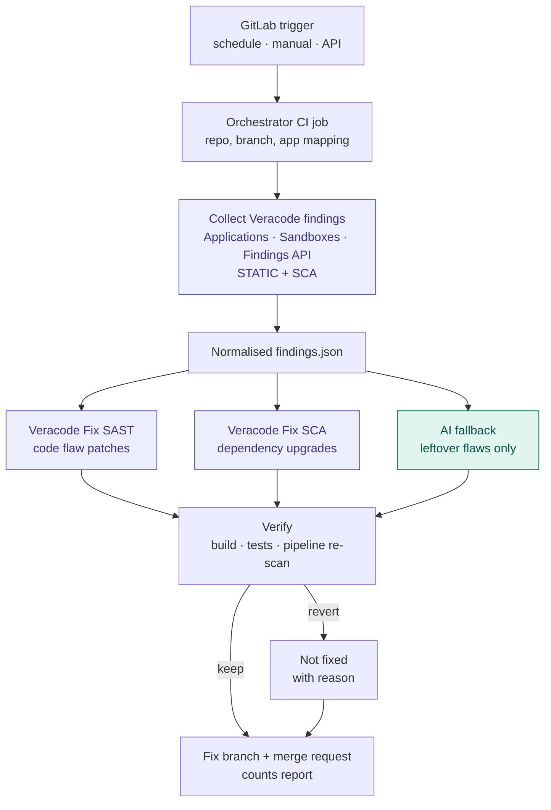

# Architecture

## Flow

1. **Trigger** – a scheduled, manual or API-triggered pipeline starts for a project and branch.
2. **Collect** – resolve the Veracode application (and branch sandbox, if any) and fetch the latest open STATIC and SCA findings (two separate Findings API calls).
3. **Fix** – Veracode Fix (SAST, then SCA) runs first; the AI fallback only receives findings Veracode Fix skipped.
4. **Verify** – each patch must build, pass tests and clear the finding in a fresh Pipeline Scan / SCA agent scan; otherwise it is reverted.
5. **Publish** – push `veracode-fix/<branch>-<pipelineId>`, open an MR, and post the Identified / Fixed (Veracode) / Fixed (AI) / Not fixed counts.
