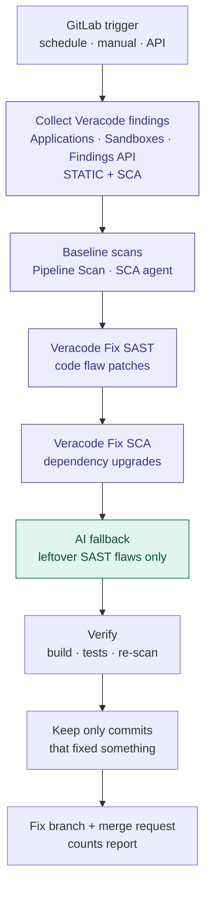

# Architecture

## Flow

| Step | Module |
|---|---|
| Collect | `autofix/collect.py`, `autofix/veracode_api.py`, `autofix/models.py` |
| Baseline scans / re-scans | `autofix/scans.py` |
| Veracode Fix SAST + SCA | `autofix/fixers/veracode_fix.py` |
| AI fallback | `autofix/fixers/ai_fix.py` |
| Verify | `autofix/verify.py` |
| Report | `autofix/report.py` |
| Publish | `autofix/gitlab.py` |
| Orchestration | `autofix/__main__.py` |

## Requirements (refined problem statement)

Build a GitLab CI-based tool that, for a GitLab project and branch:

1. Resolves the mapped Veracode application profile and, if the branch is scanned into a sandbox, that sandbox; otherwise uses the latest policy scan.
2. Fetches the latest open STATIC and SCA findings with severity, CWE/CVE, location and Veracode's remediation guidance, and stores them as `findings.json`.
3. Remediates with Veracode Fix for SAST, then Veracode Fix for SCA, then an AI fallback only for findings Veracode Fix did not patch (minimal diff, one finding per patch, no new dependencies).
4. Verifies with build, tests and a re-scan; anything that breaks the build or does not clear a finding is not kept.
5. Pushes `veracode-fix/<branch>-<pipelineId>` and opens a merge request to the source branch; never pushes to the source branch.
6. Reports per scan type and severity: Identified, Fixed by Veracode Fix, Fixed by AI, Not fixed (with reason), where Identified = the sum of the other three.

Non-functional: secrets only in masked/protected CI variables, dry-run mode, one live fix MR per branch, human review before merge.

## Key design decisions

1. **Platform findings define "identified"; local scans define "fixed".** Veracode Fix consumes results from a local static scan (Pipeline Scan) and the SCA agent, not the Findings API JSON, so the tool runs those scans before and after patching. The platform is the source of truth for what needs fixing; the before/after comparison is the evidence of what was fixed.
2. **Matching without line numbers.** Patches move code, so SAST findings are matched by CWE + file name and counted per group (before − after). SCA findings are matched by CVE.
3. **Veracode Fix first, AI second.** The licensed, security-trained engine handles what it supports; the AI only gets the gaps.
4. **Small, reviewable commits.** One commit per file for Veracode Fix SAST (it works in batch), one commit for SCA upgrades, one commit per finding for AI. Commits that did not fix anything are removed before pushing.
5. **Fail safe.** A fix stage that breaks the build is reverted; an AI patch that does not apply or breaks the build is discarded; nothing is reported as fixed without a re-scan.
6. **Commands are configuration.** Build, scan and Veracode Fix commands are environment variables with sensible defaults, so CLI changes or different stacks need no code changes.
7. **Standard library only.** No third-party runtime dependencies, which keeps the image small and the security review simple.
8. **GitLab CI template, not a service.** Uses existing runners and CI variables. A central webhook-driven service across all repositories is a natural next step.
